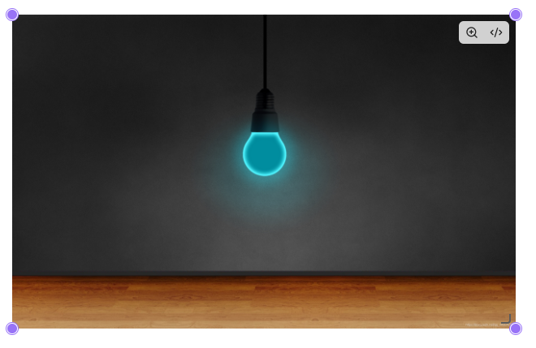
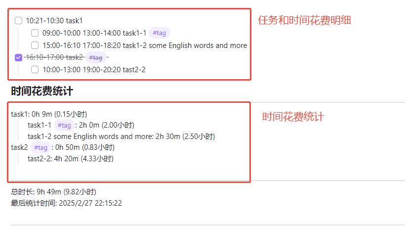
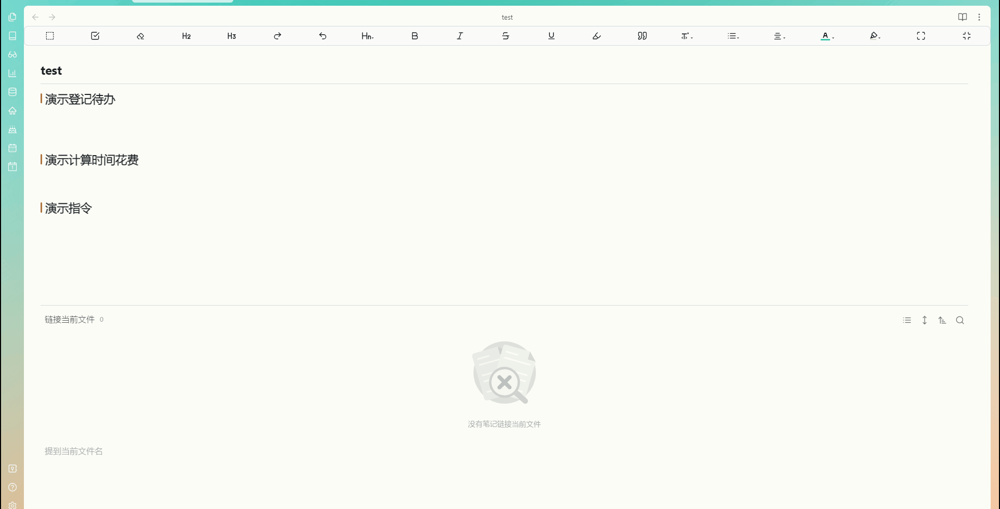
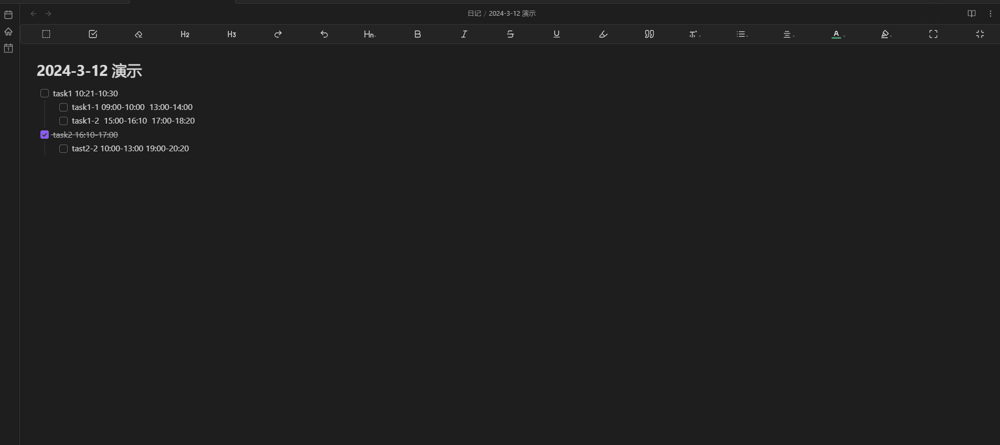
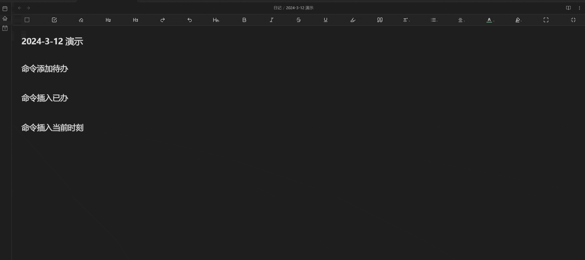
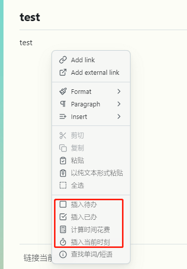

# TimeSaver

[中文文档](https://github.com/odayou/task-processing-extension/blob/master/README.md) · [Changelog](./CHANGELOG.md)

> An [Obsidian](https://obsidian.md/) plugin for processing tasks.
>
> Developed based on the needs of my own work flow and [the demand of a friend on website](https://forum-zh.obsidian.md/t/topic/30252/4). Any suggestions are welcome.

## Repository

[odayou/obsidian-task-processing-extension](https://github.com/odayou/task-processing-extension)

## ✨ 0.0.7 Highlights

- **Four-corner image resizing**: hover either `![[image]]` or `` and drag any corner to resize proportionally. The width is saved; standard Markdown images are converted to HTML images with a width attribute.
- **Three-layer non-intrusive stats UI**: status bar shows current note duration and counted notes live; a right-side panel shows total / by task / by #tag / note count; auto-compute on note open / save / editor blur.
- **Very forgiving time formats**: Chinese `2026年8月28日10:53`, concatenated date-time `2026-08-2810:53`, en-dash / hyphen mix, seconds precision, dated timestamps — written any reasonable way, it parses.
- **Cross-note aggregation & Dataview/Bases integration**: one command sums task time across all notes or a chosen folder, grouped by `#tag`, and can write results into each note's frontmatter for database queries.
- **Grouped settings with per-item toggles**: insert task / time / copy link, the stats context-menu entry, and auto-compute are all independently controllable — on by default only where you need them.

## Features

1. Calculate the time spent on each task from the recorded details (extract tasks from the current document) and show the total.
2. Quick commands: insert pending / completed tasks, insert the current time, copy link.
3. All commands are available from the command palette or the editor right-click menu (each can be toggled).
4. **Status bar live summary (v0.0.6)**: current note duration and counted notes stay on the status bar (no date-less "all notes" grand total).
5. **Right-side stats panel (v0.0.6)**: total time, per-task breakdown, by #tag, and note count — see your global time distribution at a glance.
6. **Cross-note aggregation & Dataview integration (v0.0.6)**: `Compute total time in all notes` aggregates task time across all notes (or a folder) and groups by `#tag` — the cross-note view shows the #tag breakdown and note count, **not** a date-less grand total; optionally writes into each note's YAML frontmatter.
7. **Very forgiving time formats (v0.0.6)**: Chinese dates, concatenated date-time, en-dash / hyphen, seconds and dated timestamps — see [Time format support](#time-format-support).
8. **Four-corner image resizing (v0.0.7)**: supports both Obsidian and standard Markdown images, preserving aspect ratio and saving the resized width.

## Usage

In the edit view, in a document that has tasks (standard task format) and time moments, call the command `total time` (or trigger it via the right-click menu / panel), and the time spent on each task will be listed with the total.

- For the **global view**: open the right-side panel via the left ribbon or the `Toggle TimeSaver panel` command; the status bar shows current-note duration and the count of notes computed.
- To aggregate **all notes**: run `Compute total time in all notes` (hidden from the right-click menu by default — enable `Show stats entry in context menu` in settings).
- Auto-compute is always on (no toggle): on note open, editor blur, or file save — silent recompute, no config needed.
- To resize an image, hover either `![[image]]` or `` in Live Preview and drag any corner handle. The aspect ratio stays fixed, and the width is saved when you release the pointer. Standard Markdown images are converted to HTML images with a width attribute. Adjust the corner-handle inset (0–120 px) under **Settings → Image resizing**.

## Build and install locally

Run these commands from the plugin project root:

```powershell
npm install
npm run build
```

The bundled JavaScript output is `main.js` in the project root. The build does not create a ZIP. To install manually, put `main.js`, `manifest.json`, and `styles.css` together in your vault's `.obsidian/plugins/time-saver/` folder, then enable TimeSaver under **Settings → Community plugins**. On Windows, the vault folder is commonly under `%APPDATA%\obsidian\<vault name>\.obsidian\plugins\time-saver\`; create the plugin folder if needed.

`main.js` is generated and Git-ignored, so it is not included in normal source commits. For a GitHub Release, attach it together with `manifest.json` and `styles.css`. During development, run `npm run dev` to watch source changes and rebuild `main.js` automatically.

## Preview

- Four-corner image resizing
  
- Time statistics effect display
  
- Comprehensive demo
  
- Task time statistics demo
  
- Quick commands demo
  
- All features are integrated into the right-click menu
  

## Demo

### Tasks

```markdown
- [ ] 10:21-10:30 task1 
    - [ ] 09:00-10:00 13:00-14:00 task1-1 #tag 
    - [ ] 15:00-16:10 17:00-18:20 task1-2 some English words and more 
- [x] 16:10-17:00 task2 #tag 
    - [ ] 10:00-13:00 19:00-20:20 tast2-2 
```

### Time statistics

```markdown
### 时间花费统计
---
task1: 0h 9m (0.15小时)
    task1-1 #tag: 2h 0m (2.00小时)
    task1-2 some English words and more: 2h 30m (2.50小时)
task2 #tag: 0h 50m (0.83小时)
    tast2-2: 4h 20m (4.33小时)

---
总时长: 9h 49m (9.82小时)
最后统计时间: 2025/2/27 22:15:22
```

## Panel, status bar & one-click stats (v0.0.6)

- **Status bar**: with `Show status bar` on, the bottom bar shows the current note duration and the count of notes computed, updating as you edit or switch notes; **click the status bar** to open a quick menu: compute current note, compute all notes, export stats, toggle panel. **Computing the current note no longer requires the edit mode** — reading view, a note open in another pane, or even a note restored by Obsidian at startup are all auto-computed; non-Markdown files (e.g. Canvas) show a gentle hint instead of a false "please open a Markdown note" error.
- **Right-side panel**: open via the left ribbon icon or the `Toggle TimeSaver panel` command; **when no stats yet, the panel shows `Compute current note` / `By date` / `Compute all notes` trigger buttons**; once computed it shows total, per-task detail, by #tag, and note count, with built-in `Refresh`, `Copy all`, and `Export to current note` buttons; date aggregation is additionally labeled "only daily notes" and listed per day.
- **Auto compute (always on)**: no toggle — it silently recomputes on note open (incl. files restored when Obsidian starts), editor blur, and file save; read-only scan, never rewrites your note.

## Time format support

TimeSaver is very lenient about how you write a time span. **All** of the following are recognized (each near the same `09:00–11:30` span):

| Format                       | Note                                                         |
| ---------------------------- | ------------------------------------------------------------ |
| `09:00 - 11:30`            | basic (space + hyphen)                                       |
| `09:00 – 11:30`           | en-dash (`–`) as separator                                |
| `09:00:00 - 11:30:00`      | with seconds                                                 |
| `2026-08-28 09:00 - 11:30` | dated moment (western`-`)                                  |
| `2026/08/28 9:00 - 11:00`  | slash date + single-digit hour                               |
| `2026年8月28日10:53`       | Chinese year/month/day, date**concatenated** with time |
| `2026/8/2810:53`           | slash date concatenated with time                            |
| `2026/08/2810:53`          | zero-padded date concatenated with time                      |
| `2026-08-2810:53`          | hyphen date concatenated with time                           |

Notes:

- 0 or more spaces are allowed between date and time (they may be concatenated).
- Western date separators `-` / `/` and Chinese `年 月 日` are both supported.
- When the end moment omits the date, it inherits the start moment's date to avoid false midnight wrap-around.

> Note: these mixed formats have no universal standard (ISO 8601 is `2026-08-28T10:53`, different from everyday notes; JS `Date.parse` / dayjs can't parse Chinese year/month/day either), so common writings are covered explicitly via regex and can be extended as needed.

## Cross-note aggregation & Dataview integration (v0.0.6)

### Settings

Three new options in the plugin settings:

- **Scope**: `All notes` or `Specific folder`. When `Specific folder` is selected, provide a vault-relative path such as `tasks/daily`.
- **Folder**: only used when Scope = Specific folder.
- **Sync to frontmatter**: when enabled, running the aggregation command writes each task-bearing note's result into its YAML.

### Usage

From the editor right-click menu, or the command palette, run `Compute total time in all notes`. The plugin scans the target notes and shows a notice with:

- The #tag breakdown across all notes (no date-less grand total shown)
- Number of notes that contain tasks
- A `#tag`-sorted breakdown (e.g. `#writing 2h 30m`)

### Frontmatter structure

With "Sync to frontmatter" on, each task-bearing note gets:

```yaml
---
time-saver:
  total_minutes: 589
  by_tag:
    writing: 270
    meeting: 90
    ops: 229
---
```

### Query with Dataview

With [Dataview](https://github.com/dataviewjs/dataview) installed, treat TimeSaver's output as a database.

**List each note's time (DQL):**

```dataview
TABLE `time-saver`.total_minutes AS Minutes, `time-saver`.by_tag AS ByTag
FROM "tasks"
WHERE `time-saver`
```

**Cross-note tag summary (DataviewJS):**

```dataviewjs
const pages = dv.pages('"tasks"').where(p => p["time-saver"]);
const byTag = {};
let total = 0;
for (const p of pages) {
  total += (p["time-saver"].total_minutes || 0);
  const tags = p["time-saver"].by_tag || {};
  for (const [t, m] of Object.entries(tags)) byTag[t] = (byTag[t] || 0) + m;
}
dv.paragraph("Total: " + (total / 60).toFixed(1) + " hours");
dv.table(["Tag", "Minutes"], Object.entries(byTag).sort((a, b) => b[1] - a[1]).map(([t, m]) => [t, m]));
```

> Tip: `time-saver` contains a hyphen, so in DataviewJS access it with bracket notation `p["time-saver"]`.

## Aggregate by date (daily notes)

The command `Aggregate by date (daily notes)` (or the status-bar menu "Aggregate by date", or the panel "By date" button) groups **all date-named daily notes** by day, answering "how much did I spend this day / week".

> **Important and explicit expectation**: this view **only covers daily notes** — notes whose filename looks like `2026-08-28` / `2026.08.28` / `2026/08/28`. Ordinary notes (e.g. `ProjectA.md`) have no reliable date anchor, **are not counted** and never appear in the result. This is a deliberate boundary, so we don't force date-less notes into a timeline.

- The panel tops with a grey note: "Only daily notes (filename like 2026-08-28 …)".
- Results are sorted **descending by date** (most recent on top); each day shows its total and #tag breakdown.
- Time source: frontmatter first (when sync is on), otherwise a body scan; notes marked `disabled` via "Remove stats" count as 0 and are excluded.
- Honors the `Scope` / `Folder` settings: if scoped to a folder, only daily notes inside it are picked.

## Export as CSV

The command `Export stats as CSV` (or the status-bar menu "Export stats as CSV") scans all notes in the current scope and produces a **per-note** CSV:

| Column                  | Meaning                                                            |
| ----------------------- | ------------------------------------------------------------------ |
| `note` / `path`     | filename / vault path                                              |
| `is_daily` / `date` | whether it's a daily note / the daily date (blank for non-dailies) |
| `total_minutes`       | total minutes for the note                                         |
| `total_human`         | human-readable, e.g.`2h30m`                                      |
| `by_tag`              | per-#tag split, e.g. `#writing:150; #meeting:90`                 |

- Written to the vault root as `time-saver-export-YYYY-MM-DD.csv` (UTF-8 BOM, opens cleanly in Excel), **and copied to the clipboard** for pasting into a sheet / invoice / other tool.
- CSV hands your data back to you — chart it, bill it, or migrate to Toggl etc.

## Mobile

- Commands (`Compute current/all notes`, `Aggregate by date`, `Export CSV`, …) and the right-side panel are **also available on Obsidian mobile**, triggered via:
  - the left **ribbon icon** opens the TimeSaver panel (which has `Compute / By date / Refresh / Export` buttons);
  - the **command palette** (Ctrl/Cmd+P) to invoke any command directly.
- Mobile has **no status-bar menu entry** (Obsidian mobile doesn't render plugin status-bar items); auto-compute (open / blur / save) still works silently on mobile.

## Settings overview (v0.0.6)

Settings are grouped by type. Key toggles:

- **General**: UI language.
- **Insert features**: `Insert task`, `Insert time`, `Copy link` (on by default; turn off to hide from the context menu).
- **Stats & panel**: `Status bar`, `Open panel on startup`, `Show stats entry in context menu` (off by default). (Auto-compute is always on — no toggle.)
- **Cross-note aggregation**: `Scope`, `Folder`, `Sync to frontmatter`.

## Changelog

See [CHANGELOG.md](./CHANGELOG.md).
